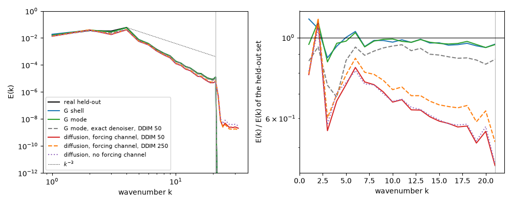
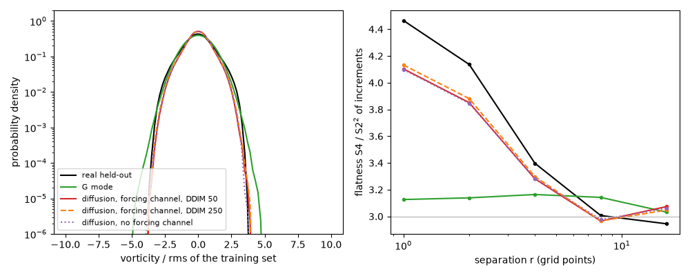
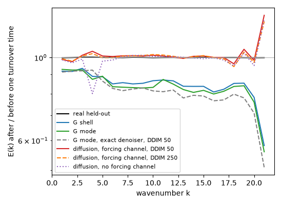
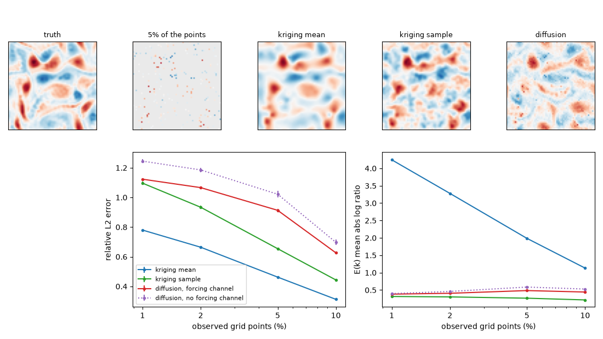
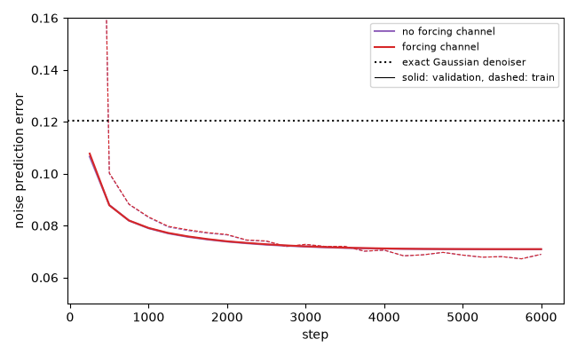

# turb-diffusion

Can a diffusion model emulate 2D turbulent vorticity fields with the right
multi-scale statistics, and where does it differ from a Gaussian random field
that has the same power spectrum?

A pseudo-spectral solver makes forced 2D Navier-Stokes data on a 64 x 64 periodic grid.
A periodic UNet is trained as a DDPM on its snapshots, with and without an input channel
that carries the pattern of the forcing. Generated fields are compared with held-out solver
fields on spectra, value distributions, structure functions, distance to the training fields
and a solver-consistency test, always next to a Gaussian random field that has the power
spectrum of the training set. A second experiment reconstructs a field from its values at
1 to 10 percent of the grid points.

## Results in short

- **Where the spectrum decides, the Gaussian field wins.** Its mean spectrum and enstrophy
  match the held-out fields by construction (E(k) error 0.042 for the per-mode field and 0.044 for
  the shell field, against 0.039 between two sets of real fields). The diffusion model does not:
  its E(k) error is 0.44 with the forcing channel and 0.43 without, its mean enstrophy is 1.46 and
  1.49 against 2.03 for held-out fields, and its spectrum lies below the real one at every shell
  except k = 2.
- **Where it does not, the diffusion model is closer to the real fields.** The flatness of
  vorticity increments at the smallest separation is 4.1 for both networks, 4.46 for held-out
  fields and 3.0 to 3.1 for the Gaussian fields. After one eddy turnover time in the solver the
  spectrum of the Gaussian fields changes by 0.17 to 0.22 (mean abs log ratio) against 0.026 and
  0.036 for the networks and 0.001 for real fields. On held-out fields the network predicts the
  noise with an error of 0.071, the exact Gaussian denoiser with 0.120.
- **The forcing channel fixes the phase, the drift under the solver and part of the
  reconstruction error, not the spectrum or the tails.** The coherence of the forced Fourier
  mode is 0.974 and 0.971 for two seeds with the channel (real fields 0.966) and 0.039 without
  it. With the channel, energy and enstrophy change by less than 2 percent in the solver (-8.3
  and -10 percent without it). The spectrum error (0.44 and 0.43 against 0.43) and the
  held-out noise error (0.0709 and 0.0707 against 0.0709) do not change, and excess kurtosis is
  a little higher (0.37 against 0.33). Reconstructions have about 10 percent lower L2 error.
- **Sparse reconstruction by replacement does not beat Gaussian conditioning.** At 1 percent of
  the points the L2 error of a diffusion reconstruction is 1.12, that of a kriging posterior
  sample 1.10 and that of the kriging mean 0.78. At 10 percent it is 0.63, 0.44 and 0.31.
- The no-channel network was trained once and the channel network twice (seeds 0 and 1), so
  every comparison between the two kinds of network rests on one run against two (see Limits).

## Results

Every table below is printed by `scripts/report.py` from the files in `results/`, and
`scripts/figures.py` draws the figures from the same files. The numbers in the text are read
from these tables and figures (the ratios of spectra from `results/diagnostics.json`). The
reference set is 500 fields from two solver trajectories that were not used for training. The
diagnostics use 500 generated fields per row and one sampler seed, the reconstruction uses 100
test fields and three sampler seeds. "Forcing channel" is the network with the extra input
channel and "no forcing channel" the one without; both have 3.57 million parameters and were
trained with the same settings. Rows and tables of the channel network are its seed 0 unless a
column says seed 1.

### The solver and its data

| quantity | value |
|---|---|
| grid | 64 x 64, 2/3 rule (modes with round(abs(k)) <= 21) |
| viscosity, drag | 0.002, 0.1 |
| forcing | 1 cos(4 y) |
| time step | 0.005 (RK4 with integrating factor) |
| rms vorticity | 2.01 |
| eddy turnover time | 0.497 |
| snapshot spacing | 0.495 (99 steps) |
| mean energy | 0.154 (std 0.0203) |
| energy, first and second half | 0.154, 0.154 |
| forced-mode coherence of the data | 0.967 |
| correlation of snapshots, lag 1 and 5 | 0.94, 0.551 |
| dt against dt / 2 after one turnover time | relative L2 1.12e-08, E(k) 5.22e-08 |
| E(k) of the data over E(k) of a 128 x 128 run | k=5: 1, k=10: 1.1, k=14: 1.2, k=18: 1.4, k=21: 3.7 |

The time step is small enough (a half step changes the fields after one turnover time by
1e-8). The 64 x 64 grid is coarse: against a run on 128 x 128 points the mean spectrum of the
data is within 20 percent at k = 5, 10 and 14 but 1.4 times larger at k = 18 and 3.7 times
larger at k = 21, so the highest shells of the data are not converged. Consecutive snapshots
are strongly correlated.

### Spectrum



The Gaussian fields (blue, green) sit on the real spectrum. Both networks fall below it at
every shell except k = 2, to 0.55 to 0.83 of it for k = 3 to 6 and 0.45 at k = 21 (ratio panel).
DDIM with 250 steps recovers part of the gap (orange dashed). The Gaussian field passed through
the exact denoiser with 50 steps (gray dashed) is below the real spectrum as well, so part of the
error belongs to the sampler. The networks also put a small share of the mean square (2.4e-4 and
2.5e-4) beyond the cutoff of the solver, where the real fields have none.

### Diagnostics

| metric | real held-out | real train | G shell | G mode | G mode, DDIM oracle | diffusion, forcing channel | diffusion, no forcing channel |
|---|---|---|---|---|---|---|---|
| E(k) mean abs log ratio, low | 0 | 0.0846 | 0.0892 | 0.0832 | 0.221 | 0.331 | 0.292 |
| E(k) mean abs log ratio, mid | 0 | 0.0255 | 0.0272 | 0.0261 | 0.0872 | 0.303 | 0.308 |
| E(k) mean abs log ratio, high | 0 | 0.0299 | 0.0375 | 0.0355 | 0.113 | 0.552 | 0.542 |
| E(k) mean abs log ratio, all | 0 | 0.0391 | 0.0444 | 0.0419 | 0.126 | 0.439 | 0.428 |
| enstrophy mean | 2.03 | 1.96 | 1.98 | 1.97 | 1.59 | 1.46 | 1.49 |
| enstrophy std | 0.346 | 0.312 | 0.292 | 0.473 | 0.289 | 0.198 | 0.212 |
| skewness | 0.0381 | -0.0306 | 0.00658 | -0.00199 | -0.00544 | -0.00952 | -0.022 |
| excess kurtosis | 0.133 | 0.131 | 0.021 | -0.0133 | -0.00577 | 0.371 | 0.331 |
| KS distance of the values | 0 | 0.00657 | 0.0141 | 0.0149 | 0.027 | 0.0432 | 0.0398 |
| S2 mean abs log ratio | 0 | 0.0272 | 0.225 | 0.0259 | 0.18 | 0.326 | 0.314 |
| S4 mean abs log ratio | 0 | 0.0589 | 0.426 | 0.186 | 0.494 | 0.662 | 0.64 |
| flatness S4 / S2^2 at r = 1 | 4.46 | 4.42 | 3 | 3.13 | 3.09 | 4.1 | 4.1 |
| forced-mode coherence | 0.966 | 0.967 | 0.0183 | 0.0572 | 0.0423 | 0.974 | 0.0393 |
| share of mean square outside k=21 | 4.2e-16 | 4.22e-16 | 4.26e-16 | 4.39e-16 | 8.24e-16 | 0.00025 | 0.000237 |
| nearest train, plain, median | 2.01 | - | 2.35 | 2.3 | 2.19 | 1.82 | 2 |
| nearest train, shifted, median | 1.74 | - | 2.18 | 2.12 | 2.01 | 1.53 | 1.71 |
| nearest train, shifted, 5th pct | 1.53 | - | 2 | 1.88 | 1.81 | 1.36 | 1.41 |



- The "real train" column is every fourth training field. It shows how far two sets of real
  fields differ in each metric (0.039 for E(k) all), which is the floor for the other columns.
- Skewness is small for every set. The Gaussian fields have excess kurtosis near 0 (0.02 and
  -0.01), the networks 0.33 and 0.37 and the held-out fields 0.13. The value distribution of the
  networks differs more from the held-out one than that of the Gaussian fields (KS distance
  0.043 and 0.040 against 0.014 and 0.015), and it is narrower: their enstrophy is lower.
- On S2 (second-order structure function) the per-mode Gaussian field is better than either
  network, as its spectrum is right. On S4 both Gaussian fields are better (0.19 and 0.43
  against 0.66 and 0.64), although their flatness is only 3.0 to 3.1. The S4 error of the
  networks is about twice their S2 error (0.66 against 0.33, 0.64 against 0.31), which is what
  increments that are too small give, since S4 scales with the square of S2 at a fixed flatness.
- The nearest-neighbour rows give the rms pixel distance to the closest of the 2000 training
  fields. The Gaussian fields are farther from every training field (median 2.19 to 2.35) than
  held-out real fields (2.01). The network without the channel is as far as real fields (2.00)
  and the one with it is closer (1.82; 1.53 against 1.74 when all symmetries are allowed; fifth
  percentile 1.36 against 1.53). Even at the fifth percentile the distance is 1.36 or more,
  far from the near-zero distance of a copy. The check cannot separate a mild pull towards the
  training fields from low amplitude, because distances fall with amplitude and the generated
  fields are weaker than real ones (enstrophy 1.46 and 1.49 against 2.03).

### Solver consistency

Each set is evolved by the solver for one snapshot spacing (0.495). A set that lies on the
attractor of the solver keeps its spectrum.

| set | low | mid | high | all | enstrophy change | energy change |
|---|---|---|---|---|---|---|
| real held-out | 0.00154 | 0.000647 | 0.00091 | 0.000956 | 0.000846 | 0.000511 |
| real train | 0.000457 | 0.0048 | 0.0067 | 0.00497 | 3.65e-05 | 6.01e-05 |
| G shell | 0.0887 | 0.15 | 0.212 | 0.171 | -0.115 | -0.0936 |
| G mode | 0.0906 | 0.173 | 0.233 | 0.188 | -0.121 | -0.099 |
| G mode, DDIM oracle | 0.0835 | 0.188 | 0.287 | 0.22 | -0.109 | -0.087 |
| diffusion, forcing channel | 0.0226 | 0.00978 | 0.0364 | 0.0262 | 0.0183 | 0.00607 |
| diffusion, no forcing channel | 0.0699 | 0.0125 | 0.0368 | 0.0362 | -0.1 | -0.0828 |



The Gaussian fields leave the attractor at once: the spectrum changes by 0.17 to 0.22 and 9 to
12 percent of the energy and enstrophy are lost. The networks keep the shape of the spectrum much
better (0.026 and 0.036; real fields 0.001). The network without the channel loses 8 and 10
percent of its energy and enstrophy and its spectrum drops by 20 percent at k = 4, the forced
shell; a random phase of the forced mode would explain this, but the cause was not tested
separately. With the channel the energy and enstrophy change by less than 2 percent. For both
networks the spectrum at k = 21, the last shell the solver keeps, rises by 30 and 26 percent
(with and without the channel).

### Sparse-observation reconstruction

Network with the forcing channel (relative L2 error and E(k) error, mean and standard deviation
over three seeds):

| observed | L2 kriging mean | L2 kriging sample | L2 diffusion | E(k) kriging mean | E(k) kriging sample | E(k) diffusion |
|---|---|---|---|---|---|---|
| 1% (41 points) | 0.78 +- 0.0014 | 1.1 +- 0.011 | 1.12 +- 0.0054 | 4.25 +- 0.018 | 0.315 +- 0.004 | 0.382 +- 0.0086 |
| 2% (82 points) | 0.664 +- 0.0061 | 0.934 +- 0.01 | 1.07 +- 0.0031 | 3.28 +- 0.0097 | 0.303 +- 0.0056 | 0.407 +- 0.0019 |
| 5% (205 points) | 0.463 +- 0.0022 | 0.654 +- 0.0041 | 0.913 +- 0.0086 | 1.99 +- 0.0013 | 0.266 +- 0.0016 | 0.484 +- 0.0042 |
| 10% (410 points) | 0.313 +- 0.0043 | 0.443 +- 0.0041 | 0.626 +- 0.006 | 1.13 +- 0.014 | 0.216 +- 0.0015 | 0.443 +- 0.004 |

The same experiment with the network without the forcing channel (the kriging columns are the
same, they do not depend on the network):

| observed | L2 kriging mean | L2 kriging sample | L2 diffusion | E(k) kriging mean | E(k) kriging sample | E(k) diffusion |
|---|---|---|---|---|---|---|
| 1% (41 points) | 0.78 +- 0.0014 | 1.1 +- 0.011 | 1.24 +- 0.013 | 4.25 +- 0.018 | 0.315 +- 0.004 | 0.397 +- 0.0097 |
| 2% (82 points) | 0.664 +- 0.0061 | 0.934 +- 0.01 | 1.19 +- 0.014 | 3.28 +- 0.0097 | 0.303 +- 0.0056 | 0.46 +- 0.0073 |
| 5% (205 points) | 0.463 +- 0.0022 | 0.654 +- 0.0041 | 1.02 +- 0.022 | 1.99 +- 0.0013 | 0.266 +- 0.0016 | 0.585 +- 0.0084 |
| 10% (410 points) | 0.313 +- 0.0043 | 0.443 +- 0.0041 | 0.697 +- 0.018 | 1.13 +- 0.014 | 0.216 +- 0.0015 | 0.528 +- 0.023 |



Figure: one test field with 5 percent of its points observed, the three reconstructions, and
the two errors against the fraction of observed points (error bars are the standard deviation over
three seeds).

- The kriging mean is the best estimate in L2 error and is smooth, so its spectrum is too low
  at high k (E(k) error 1.1 to 4.3). The fair comparison for the diffusion model is the kriging
  sample, which is a sample as well.
- The diffusion reconstructions are worse than the kriging sample in L2 error at every fraction
  (1.12 against 1.10 at 1 percent, 0.63 against 0.44 at 10 percent) and in the E(k) error
  (0.38 to 0.48 against 0.22 to 0.32). Their relative L2 error is above 1, which is the error of
  estimating zero, at 1 and 2 percent of the points with the channel and up to 5 percent without it.
- The network with the forcing channel reconstructs better than the one without (1.12, 1.07,
  0.91, 0.63 against 1.24, 1.19, 1.02, 0.70). Replacement conditioning is a plain scheme and is
  not an exact posterior sampler.

### Sampler and network variants

| set | E(k) all | enstrophy mean | S4 | coherence | relaxation |
|---|---|---|---|---|---|
| G mode, DDIM oracle | 0.126 | 1.59 | 0.494 | 0.0423 | 0.22 |
| G mode, DDIM oracle 250 | 0.065 | 1.74 | 0.343 | 0.0423 | 0.21 |
| diffusion, forcing channel | 0.439 | 1.46 | 0.662 | 0.974 | 0.0262 |
| diffusion, forcing channel, DDIM 250 | 0.356 | 1.53 | 0.544 | 0.971 | 0.0241 |
| diffusion, forcing channel, early checkpoint | 0.447 | 1.32 | 0.677 | 0.949 | 0.0733 |
| diffusion, no forcing channel | 0.428 | 1.49 | 0.64 | 0.0393 | 0.0362 |

DDIM with 250 steps lowers the spectrum and S4 errors of the network with the channel (0.44 to
0.36 and 0.66 to 0.54) and the same happens for the Gaussian oracle (0.126 to 0.065). In this
run the early checkpoint (step 1000) has about the same spectrum error as the final one (0.45
against 0.44) but lower enstrophy (1.32 against 1.46) and a larger drift under the solver (0.073
against 0.026): training longer helped the amplitude and the consistency more than the shape
of the spectrum.

The start of the DDIM chain matters. The cosine schedule ends at a signal level of 2.4e-9, and a
chain that starts there gives fields with a mean enstrophy about 5e4 times that of the
validation fields. Starting at the last step with a signal level of at least 1e-3 (timestep
978) is the setting used everywhere above. The tables compare the start levels on the validation
trajectory, first for the network without the forcing channel and then for the one with it:

| alpha_bar at the start | start timestep | first clean estimate, rms | enstrophy / validation | share of mean square outside k=21 | E(k) all |
|---|---|---|---|---|---|
| 0.0 | 999 | 297 | 5.68e+04 | 0.323 | 11.7 |
| 1e-06 | 998 | 8.29 | 1.67 | 0.00753 | 0.216 |
| 0.0001 | 992 | 1.02 | 0.788 | 0.000815 | 0.307 |
| 0.001 | 978 | 0.406 | 0.734 | 0.00025 | 0.368 |
| 0.01 | 934 | 0.455 | 0.623 | 0.000332 | 0.319 |

| alpha_bar at the start | start timestep | first clean estimate, rms | enstrophy / validation | share of mean square outside k=21 | E(k) all |
|---|---|---|---|---|---|
| 0.0 | 999 | 277 | 4.82e+04 | 0.311 | 11.7 |
| 1e-06 | 998 | 7.82 | 1.48 | 0.00995 | 0.208 |
| 0.0001 | 992 | 1.07 | 0.79 | 0.000641 | 0.328 |
| 0.001 | 978 | 0.503 | 0.733 | 0.000252 | 0.375 |
| 0.01 | 934 | 0.529 | 0.626 | 0.000304 | 0.358 |

### Networks and seeds

The network with the forcing channel was trained a second time with seed 1 (the network without
it once). The table sets the three runs side by side with the same samples and metrics.

| metric | no forcing channel, seed 0 | forcing channel, seed 0 | forcing channel, seed 1 |
|---|---|---|---|
| held-out noise error | 0.0709 | 0.0709 | 0.0707 |
| E(k) mean abs log ratio, low | 0.292 | 0.331 | 0.336 |
| E(k) mean abs log ratio, mid | 0.308 | 0.303 | 0.317 |
| E(k) mean abs log ratio, high | 0.542 | 0.552 | 0.53 |
| E(k) mean abs log ratio, all | 0.428 | 0.439 | 0.432 |
| enstrophy mean | 1.49 | 1.46 | 1.44 |
| enstrophy std | 0.212 | 0.198 | 0.206 |
| excess kurtosis | 0.331 | 0.371 | 0.373 |
| KS distance of the values | 0.0398 | 0.0432 | 0.0443 |
| S2 mean abs log ratio | 0.314 | 0.326 | 0.336 |
| S4 mean abs log ratio | 0.64 | 0.662 | 0.679 |
| flatness S4 / S2^2 at r = 1 | 4.1 | 4.1 | 4.11 |
| forced-mode coherence | 0.0393 | 0.974 | 0.971 |
| E(k) change after one turnover time | 0.0362 | 0.0262 | 0.0274 |
| enstrophy change after one turnover time | -0.1 | 0.0183 | 0.0187 |
| energy change after one turnover time | -0.0828 | 0.00607 | 0.00579 |
| reconstruction L2, 1% of the points | 1.24 | 1.12 | 1.12 |
| reconstruction L2, 2% of the points | 1.19 | 1.07 | 1.07 |
| reconstruction L2, 5% of the points | 1.02 | 0.913 | 0.923 |
| reconstruction L2, 10% of the points | 0.697 | 0.626 | 0.647 |

- Same in both seeds of the channel network and different from the no-channel run by more than
  the two seeds differ: the forced-mode coherence (0.974 and 0.971 against 0.039), the change of
  energy and enstrophy in the solver (+0.6 and +1.8 percent, +0.6 and +1.9 percent, against -8.3
  and -10 percent), the E(k) change (0.026 and 0.027 against 0.036) and the reconstruction L2 error
  (1.12 and 1.12 against 1.24 at 1 percent of the points, 0.63 and 0.65 against 0.70 at 10 percent).
- Not different, or by about as much as the two seeds differ: the E(k) error (0.439 and 0.432
  against 0.428) and the held-out noise error (0.0709 and 0.0707 against 0.0709).
- Slightly worse with the channel in both seeds: the low band of the spectrum (0.33 and 0.34
  against 0.29), excess kurtosis (0.371 and 0.373 against 0.331) and the KS distance (0.043 and
  0.044 against 0.040), where the gap between the two kinds of network is 7 to 8, about 20 and
  3 to 4 times the gap between the seeds. S2 (0.33 and 0.34 against 0.31), S4 (0.66 and 0.68
  against 0.64) and a lower mean enstrophy (1.46 and 1.44 against 1.49) differ by only one to
  three times the gap between the seeds. The no-channel network has one run, so its own spread is
  not known.

### Training

- no forcing channel: 3,566,977 parameters, 6000 steps of batch 64 on Tesla T4 in 22 minutes, final train loss 0.0689, held-out loss 0.0709, selected step 5750 (held-out loss 0.0709).
- forcing channel: 3,567,409 parameters, 6000 steps of batch 64 on Tesla T4 in 21.3 minutes, final train loss 0.069, held-out loss 0.0709, selected step 5750 (held-out loss 0.0709).
- forcing channel, seed 1: 3,567,409 parameters, 6000 steps of batch 64 on Tesla T4 in 19.7 minutes, final train loss 0.0672, held-out loss 0.0707, selected step 5750 (held-out loss 0.0707).
- exact Gaussian denoiser, same held-out fields, timesteps and noise: loss 0.12.



The two curves lie on top of each other. The training error is a running mean over 250 steps with
dropout on, the held-out error comes from the EMA weights without dropout; the training error is
above the held-out error until step 3500 and below it from step 3750.

## What is in the repo

| path | content |
|---|---|
| `src/turbdiff/solver.py` | pseudo-spectral solver (integrating-factor RK4, 2/3 rule), batched, CPU or GPU |
| `src/turbdiff/spectra.py` | shell spectra E(k), isotropic averaging, band errors |
| `src/turbdiff/gaussian.py` | Gaussian random field (per mode or per shell), kriging, exact Gaussian denoiser |
| `src/turbdiff/unet.py`, `diffusion.py` | periodic UNet with an optional forcing channel, cosine schedule, DDPM loss, DDIM sampler with replacement conditioning, EMA |
| `src/turbdiff/data.py` | trajectory generation, symmetries of the flow and random augmentation, loading |
| `src/turbdiff/diagnostics.py`, `reconstruct.py` | PDF moments, structure functions, nearest-neighbour check, reconstruction metrics |
| `scripts/make_data.py`, `check_solver.py` | data generation and solver checks, write `results/solver.json` |
| `scripts/train.py`, `sampler_start.py`, `evaluate.py`, `reconstruct.py` | training, DDIM start comparison, diagnostics and solver consistency, sparse-observation experiment |
| `scripts/report.py`, `figures.py` | markdown tables and figures from `results/` |
| `tests/` | analytic tests of the solver and of every other module (56 tests) |
| `results/` | JSON, CSV, NPZ and PNG files that the tables and figures above come from (no weights) |

## Reproduce

On a laptop CPU (data generation takes about six minutes with four threads, the tests under
half a minute on an idle machine):

```
pip install -e ".[dev]"
pytest -q
python scripts/make_data.py          # data/turb.npz, results/solver.json
python scripts/check_solver.py       # adds the checks to results/solver.json
```

Training, evaluation and the reconstruction experiment ran on a Colab T4 with the
`data/turb.npz` made on the laptop. The first block is the network without the
forcing channel, the second the network with it, the third a second seed of that network:

```
python scripts/train.py --steps 6000 --compile
python scripts/sampler_start.py
python scripts/evaluate.py --early work/ema_1000.pt
python scripts/reconstruct.py
cp results/reconstruction.json results/reconstruction_plain.json

python scripts/train.py --steps 6000 --compile --forcing --tag _forcing --work work_forcing
python scripts/sampler_start.py --forcing --work work_forcing
python scripts/evaluate.py --forcing --work work_forcing --early work_forcing/ema_1000.pt --plain work/ema.pt
python scripts/reconstruct.py --forcing --work work_forcing

python scripts/train.py --steps 6000 --compile --forcing --seed 1 --tag _forcing_seed1 --work work_seed1 --results results_seed1
python scripts/evaluate.py --forcing --work work_seed1 --results results_seed1
python scripts/reconstruct.py --forcing --work work_seed1 --results results_seed1

python scripts/figures.py && python scripts/report.py
```

The runs behind `results/` wrote the networks to separate result folders, which were then
merged by copying the files to the names above. For the second seed the folder needs a copy of
`results/solver.json`, and its `diagnostics.json`, `consistency.json` and `reconstruction.json`
are the files `results/diagnostics_forcing_seed1.json`, `results/consistency_forcing_seed1.json`
and `results/reconstruction_forcing_seed1.json`. Training takes about 20 to 22 minutes per
network, the evaluation 6 to 8 minutes and the reconstruction about 3 minutes on the T4.

## Method notes

**Solver.** The vorticity $\omega$ on $[0, 2\pi)^2$ follows
$\partial_t \omega + u \cdot \nabla \omega = \nu \nabla^2 \omega - \mu \omega + a \cos(k_f y)$,
with the velocity $u$ from the stream function ($\nabla^2 \psi = -\omega$).
The parameters are $\nu = 0.002$, $\mu = 0.1$, $a = 1$, $k_f = 4$ on a 64 x 64 grid.
Products are formed on the grid and every mode with round(|k|) above 21 (the 2/3 rule) is
removed after each evaluation of the advection term. Time stepping is RK4 with an
integrating factor for viscosity and drag, $dt = 0.005$. A trajectory starts from a smooth
random field and runs 100 time units of spin-up. The eddy turnover time $1/\omega_\mathrm{rms}$
is measured over the next 20 time units, and snapshots are taken every 99 steps (0.495 time
units, the turnover time rounded to whole steps).

**Data.** Seeds 0 to 3 give the four training trajectories (500 snapshots each, 2000
fields), seeds 100 and 101 the two held-out test trajectories (250 snapshots each, 500
fields), seed 200 a validation trajectory (250 fields) that selects the checkpoint, the DDIM
start and the replacement variant. Fields are divided by the standard deviation of the
training set (1.98).

**Gaussian random field G.** "G mode" draws fields with the mean power of every Fourier mode
of the training set, "G shell" with that power averaged over the shells of constant round(|k|).
Both have zero mean. "G mode, DDIM oracle" samples the same Gaussian field with DDIM and the
exact noise predictor of that field: it shows what the sampler alone does to a Gaussian
field, as if a network had learned it without error.

**Diffusion model.** DDPM with the cosine schedule (1000 steps) and noise prediction. The
UNet uses circular padding in every convolution, widths 48, 96, 96, 96, two residual blocks
per level, self-attention at the 8 x 8 level, dropout 0.1, 3.57 million parameters.
Training: AdamW (learning rate 3e-4, 500 warm-up steps, cosine decay to 10 percent, weight
decay 0.01), batch 64, 6000 steps, fp16 autocast, gradient clipping at 1, EMA of the weights
(decay 0.999) and a random symmetry of the flow applied to every training field (shifts
along x, shifts along y by multiples of the forcing period, the half turn, and the reflection
with a half-period shift in y). The EMA weights are saved every 250 steps and the checkpoint
with the lowest noise-prediction error on the validation fields is kept. Samples come from
deterministic DDIM, 50 steps unless stated, starting at the last timestep whose signal level
$\bar\alpha$ is at least $10^{-3}$. At the end of the cosine schedule $\bar\alpha = 2.4 \cdot 10^{-9}$ and the
clean estimate multiplies the error of the network by $2 \cdot 10^{4}$; the sampler-start
table shows the effect of starting there.

**Forcing channel.** With the option on, the network input gets a second channel
$\cos(k_f y)$, the pattern of the forcing. Without it the UNet commutes with shifts by
multiples of its total stride (8 pixels, a divisor of the forcing period of 16), so nothing
ties the phase of a generated flow to the forcing. The forced-mode coherence in the diagnostics
table measures that phase.

**Diagnostics.** E(k) is the shell-summed kinetic energy spectrum (shell round(|k|), k = 1 to
32). "E(k) mean abs log ratio" is the mean over the shells of a band of $|\log(E/E_\mathrm{ref})|$
for the mean spectrum of a set against the real held-out set (low 1 to 4, mid 5 to 10, high 11
to 21, all 1 to 21). Enstrophy is $\tfrac12\langle\omega^2\rangle$ per field. Skewness, excess
kurtosis and the Kolmogorov-Smirnov distance use the values pooled over fields.
S2 and S4 are the second and fourth moments of $|\omega(x + r) - \omega(x)|$ for
r = 1, 2, 4, 8, 16 along x and y, compared as the mean of $|\log(S/S_\mathrm{ref})|$.
Forced-mode coherence is the modulus of the mean over fields of the Fourier coefficient of
the forced mode divided by its root mean square: 1 when every field has the same phase,
near 0 for random phases. The nearest-neighbour rows give the rms pixel distance from each
field to the closest of the 2000 training fields, as it is (plain) and with the best of all
symmetries of the flow (shifted).

**Solver consistency.** Each set of fields is evolved by the solver for one snapshot spacing
(0.495) and the mean spectrum before and after is compared in the same way. Real fields stay
on the attractor of the solver and change little; fields that are off it relax.

**Reconstruction.** The observed grid points are chosen at random (100 test fields, three
seeds that fix both the points and the sampler noise). Kriging is the Gaussian conditioning
with the per-mode power of the training set: the posterior mean ("kriging mean") or a posterior
sample ("kriging sample"). The diffusion reconstruction is DDIM with replacement: after every
step the observed pixels are reset to the observed values noised to the level of the next
step, with either a fresh noise draw or the noise the network predicted at that step. The
variant with the lower relative L2 error on 50 validation fields (mean over the four
percentages) is used on the test fields. The relative L2 error is $\lVert\hat\omega - \omega\rVert / \lVert\omega\rVert$ per field,
the E(k) error is the mean of $|\log(E/E_\mathrm{true})|$ over shells 1 to 21 per field, both averaged over fields,
then over the three seeds (with their standard deviation).

## Limits

- Two dimensions, a 64 x 64 grid, one forcing ($k_f = 4$) and one setting of viscosity and drag.
  Nothing here says anything about three-dimensional turbulence or about other flows.
- The solver data are not converged at the highest shells (see the solver table), so "the right
  statistics" means the statistics of this solver's output on this grid.
- The training set is 2000 fields from four trajectories whose neighbouring snapshots are strongly
  correlated, and the reference is 500 fields from two other trajectories. The network without the
  channel was trained once (seed 0) and the one with it twice (seeds 0 and 1); the diagnostics use
  one sampler seed, the reconstruction three. A difference between the two kinds of network is a
  difference between one run and two, and no confidence interval is given for it.
- The diffusion model is worse than the Gaussian field on the spectrum, enstrophy and
  structure-function rows, and its amplitude is too low. The sampler explains part of the spectrum
  error, not all of it (the network with 250 DDIM steps is still at 0.36 against 0.065 for the
  Gaussian oracle).
- The reconstruction by replacement is a simple scheme and did not beat Gaussian conditioning. A
  sampler that targets the posterior (or a network trained for the observation pattern) may do
  better; none was tried.
- The DDIM start, the replacement variant and the checkpoint were chosen on the validation
  trajectory, never on the test fields. The network and training settings were fixed once and
  not searched.
- The nearest-neighbour check looks for near copies. It does not rule out weaker forms of
  memorisation of 2000 strongly correlated training fields.
- Timings come from one T4 session and include the compile time of the first steps.

## License

Apache-2.0, see `LICENSE`.
